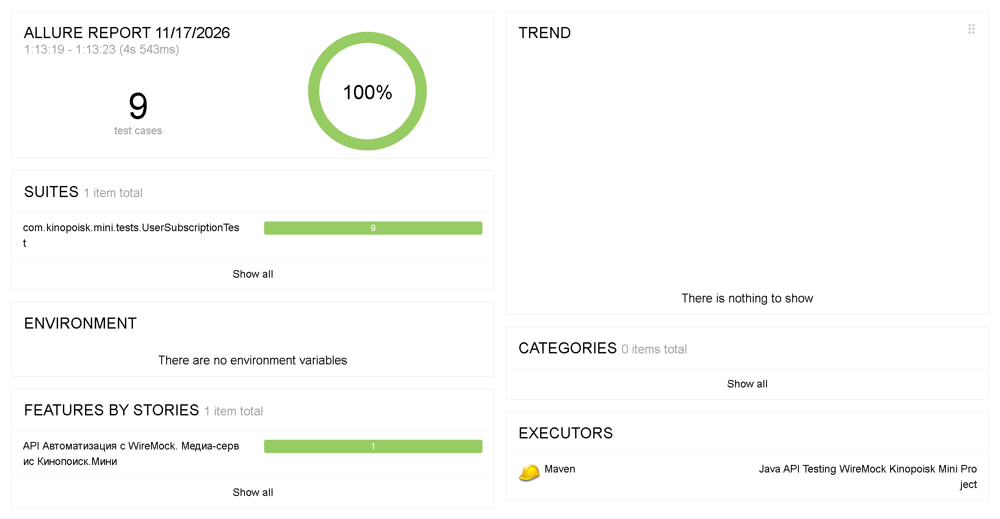
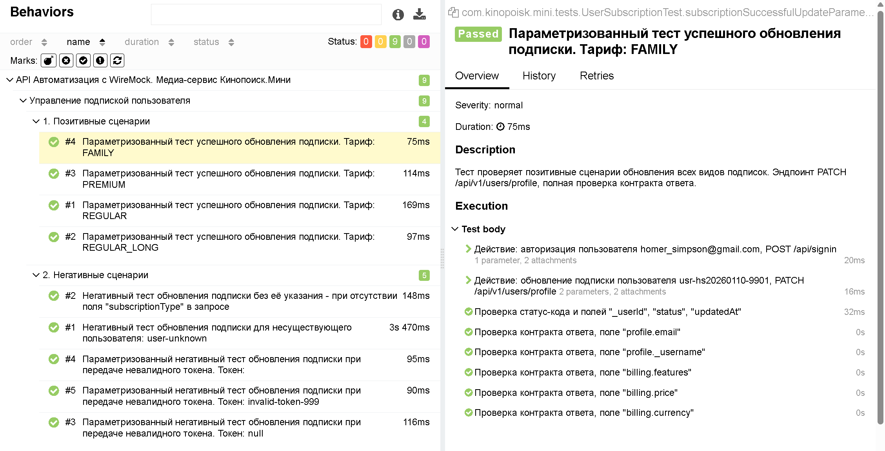
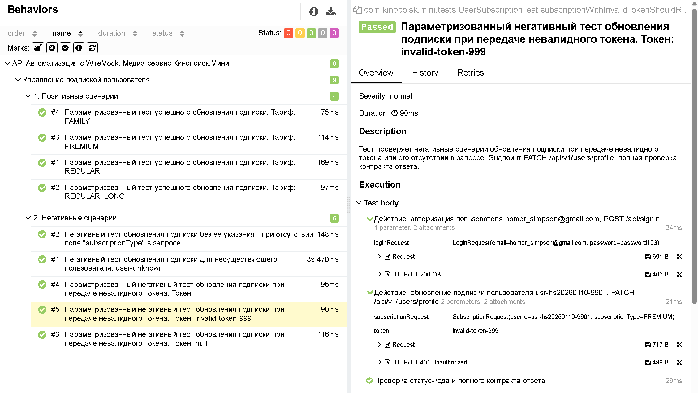

[](https://github.com)
[](https://leonidgorbunov.github.io/java-api-wiremock-subscription)
# Java API Testing WireMock Subscription Project

**Контекст и цели проекта**: проектирование фреймворка контрактного и компонентного API-тестирования (REST Client Architecture) с полной изоляцией от реального бэкенда с помощью виртуального HTTP-сервера **WireMock 3.x**, сериализацией/десериализацией многоуровневых JSON-контрактов через **Jackson** и комбинированной валидацией ответов.

**ТЗ (вид работ)**: автоматизация тестирования REST API в условиях отсутствия/изоляции бэкенда, разработка стабов с приоритетами и JSONPath-матчингом (`WireMock`), проектирование DTO-моделей (`Lombok` + `Jackson`), гибридная валидация ответов (`Fluent REST Assured` + `JUnit 5 assertAll`) и настройка CI/CD отчетов (`Allure` + `GitHub Pages`).

**Продукт**: REST-бэкенд управления подписками медиа-сервиса **Кинопоиск.Мини** (`POST /api/signin`, `PATCH /api/v1/users/profile`).

**Выполненные задачи**:
1. **REST Client Architecture**: спроектирован базовый абстрактный слой `BaseClient` с неизменяемой спецификацией `BASE_SPEC` (`RequestSpecBuilder`), инкапсулирующей `ContentType.JSON`, логирование (`LogDetail.URI`, `LogDetail.BODY`) и фильтрацию `AllureRestAssured`. Дочерние клиенты `LoginClient` и `ProfileClient` полностью изолированы от тестового слоя и поддерживают гибкую передачу Bearer-токенов (включая отсутствие или пустое значение токена).
2. **Виртуализация бэкенда с приоритетами (WireMock 3.x)**: спроектирован независимый конфигуратор заглушек `SubscriptionStubs`, эмулирующий конвейер обработки запросов на одном эндпоинте `PATCH /api/v1/users/profile` с помощью приоритетов (`atPriority`) и JSONPath-матчинга (`matchingJsonPath`):
    * **Приоритет `1` (Security Filter):** отсекает запросы без заголовка `Authorization` (`absent()`) или с невалидным токеном (`notMatching(...)`) с кодом `401 Unauthorized`.
    * **Приоритет `2` (Validation & Business Rules):** проверяет существование пользователя (`$._userId` → `404 Not Found`) и обязательность поля подписки (`$[?(!@.subscriptionType)]` → `400 Bad Request`).
    * **Приоритет `3` (Success Flow):** возвращает актуальное состояние профиля и биллинга (`200 OK`) для каждого тарифа из `SubscriptionType`.
3. **Многоуровневые DTO и управление сериализацией (Lombok + Jackson)**: реализованы типизированные модели запросов и ответов с маппингом полей (`@JsonProperty("_userId")`, `@JsonProperty("_username")`, `@JsonProperty("auth_token")`), управлением `null`-полями при `PATCH`-сериализации (`@JsonInclude(JsonInclude.Include.NON_NULL)`), статическими вложенными классами (`SubscriptionResponse.Profile`, `SubscriptionResponse.Billing`) и `enum SubscriptionType`, хранящим бизнес-параметры тарифов (`price` и `List<String> features`).
4. **Единый источник данных (Zero Hardcode)**: маршруты API и эталонные тестовые сущности вынесены в `@UtilityClass` константы (`ApiEndpoints`, `TestData`), а HTTP-статусы — в константы `org.apache.http.HttpStatus`, что полностью исключает расхождение данных между моками WireMock и проверками в тестах.
5. **Гибридная валидация контрактов и параметризация JUnit 5**: реализованы 9 тестовых запусков с использованием `@EnumSource` и `@MethodSource`. В позитивных тестах транспортный уровень и верхние поля валидируются через `Fluent REST Assured` (`describedAs()`), а сложные вложенные объекты `Profile` и `Billing` десериализуются через Jackson и проверяются группой `assertAll` с пошаговой детализацией через `Allure.step`. Негативные контракты ошибок проверяются цепочкой `ValidatableResponse`.

**Область тестирования (Scope)**:
* **Позитивные сценарии (`200 OK`):** параметризованная смена подписки на все доступные тарифы (`REGULAR`, `REGULAR_LONG`, `PREMIUM`, `FAMILY`) с полной проверкой контракта ответа, профиля пользователя, стоимости, валюты и списка доступных опций (`features`).
* **Негативные сценарии (`401` / `404` / `400`):** параметризованная проверка отсутствия токена (`null`), пустого токена (`""`) и невалидного токена (`401 Unauthorized`); попытка обновления подписки для несуществующего `_userId` (`404 Not Found`); отправка `PATCH`-запроса без обязательного поля `subscriptionType` (`400 Bad Request`).

**Окружение**: Java (JDK 11), JUnit 5, REST Assured 5.5, WireMock Standalone 3.9.1, Jackson, Project Lombok, Allure Reporting, AspectJ Weaver Agent, Maven.

---

### 🏗 Архитектура и структура проекта

```text
java-api-wiremock-subscription/
├── .github/
│   └── workflows/
│       └── ci.yml                                    # CI/CD пайплайн: прогон тестов и публикация Allure на GitHub Pages
├── src/
│   └── test/
│       ├── java/
│       │   └── com/kinopoisk/mini/
│       │       ├── client/                           # Сетевой слой (REST Assured)
│       │       │   ├── BaseClient.java               # Базовая RequestSpecification (Content-Type, логирование, AllureRestAssured)
│       │       │   ├── LoginClient.java              # Клиент авторизации (POST /api/signin)
│       │       │   └── ProfileClient.java            # Клиент управления подпиской (PATCH /api/v1/users/profile)
│       │       ├── constants/                        # Единый источник правды (Single Source of Truth)
│       │       │   ├── ApiEndpoints.java             # Константы маршрутов API
│       │       │   └── TestData.java                 # Эталонные тестовые данные (креды, токены, userId, валюта, таймстемпы)
│       │       ├── models/                           # POJO / DTO модели контрактов (Lombok + Jackson)
│       │       │   ├── request/
│       │       │   │   ├── LoginRequest.java         # Модель запроса авторизации
│       │       │   │   ├── SubscriptionRequest.java  # Модель PATCH-запроса (@JsonProperty, @JsonInclude(NON_NULL))
│       │       │   │   └── SubscriptionType.java     # Enum тарифов (REGULAR, REGULAR_LONG, PREMIUM, FAMILY) с ценами и опциями
│       │       │   └── response/
│       │       │       ├── ErrorCode.java            # Enum машиночитаемых кодов ошибок (400 / 401 / 404)
│       │       │       ├── ErrorResponse.java        # Модель ответа при ошибках контракта и доступа
│       │       │       ├── LoginResponse.java        # Модель ответа авторизации (snake_case auth_token -> token)
│       │       │       └── SubscriptionResponse.java   # Составная модель ответа со статическими классами Profile и Billing
│       │       ├── stubs/                            # Конфигурация заглушек виртуального сервера
│       │       │   └── SubscriptionStubs.java        # Стабы WireMock с приоритетами (1 -> 2 -> 3) и JSONPath-матчингом
│       │       └── tests/                            # Тестовый слой
│       │           ├── BaseTest.java                 # Поднятие @WireMockTest на случайном порту и инициализация стабов/клиентов
│       │           └── UserSubscriptionTest.java     # Позитивные и негативные сценарии для PATCH /api/v1/users/profile
│       └── resources/
│           └── allure.properties                     # Перенаправление allure-results в target/allure-results
├── .gitignore
└── pom.xml                                           # Конфигурация зависимостей, Lombok annotationProcessor и плагинов Surefire/Allure
```

---

### Визуализация тестового репортинга Allure & BDD Behaviors

#### 1. Общая сводка выполнения по сценариям (Behaviors Overview)
Финальная статистика прохождения всех 9 тестовых запусков в группировке `Epic → Feature → Story` (`1. Позитивные сценарии` и `2. Негативные сценарии`). Демонстрирует 100% успешное покрытие позитивных и негативных веток `PATCH /api/v1/users/profile`.


#### 2. Позитивный параметризованный сценарий (Тариф `FAMILY`)
Детализация выполнения позитивного сценария из `@EnumSource(SubscriptionType.class)` для тарифа `FAMILY`. В отчёте зафиксированы транспортный запрос, Fluent-валидация верхних полей контракта и пошаговая проверка вложенных объектов `profile` и `billing` через `Allure.step`.


#### 3. Негативный сценарий авторизации (`401 Unauthorized` — `invalid-token-999`)
Результат выполнения параметризованного негативного теста из `@MethodSource("provideInvalidTokens")` при передаче невалидного Bearer-токена. Демонстрирует перехват HTTP-запроса/ответа от WireMock (с приоритетом стаба `1`) и валидацию контракта ошибки (`error_code: UNAUTHORIZED`).


---

### 📊 Живой отчёт Allure и запуск в CI/CD (GitHub Actions)

* **Интерактивный отчёт последнего прогона:** [Открыть Allure Report на GitHub Pages](https://leonidgorbunov.github.io/java-api-wiremock-subscription)
* **Автоматический прогон в облаке:** в репозиторий интегрирован пайплайн [GitHub Actions](.github/workflows/ci.yml), который разворачивает окружение на базе JDK 11, выполняет `mvn clean test`, подтягивает историю прошлых прогонов, генерирует HTML-отчёт через `allure-maven` и публикует его в ветку `gh-pages`.
